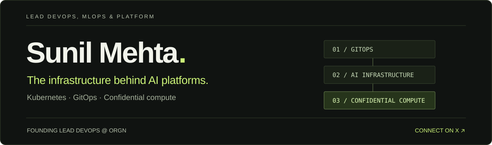

  <a href="https://sunilmehta.si"><strong>sunilmehta.si ↗</strong></a>
  &nbsp;&nbsp;·&nbsp;&nbsp;
  <a href="https://www.linkedin.com/in/sunilmehta-si/"><strong>LinkedIn ↗</strong></a>
  &nbsp;&nbsp;·&nbsp;&nbsp;
  <a href="https://orgn.com">Building at ORGN</a>
  &nbsp;&nbsp;·&nbsp;&nbsp;
  <a href="https://x.com/sunilmehta_si"><strong>Connect on X</strong></a>

## I build the infrastructure AI products run on.

I'm **Sunil Mehta**, a lead DevOps, MLOps and platform engineer and founding lead at **[ORGN](https://orgn.com)**. I work across cloud infrastructure, confidential computing, identity, and the systems that turn AI capabilities into dependable products.

My scope runs from `terraform plan` to production traffic: **Kubernetes and GitOps, confidential compute, and secure delivery pipelines**.

### Selected engineering work

| Area | What I've built and operated |
| :--- | :--- |
| **Confidential computing** | Hardware-isolated Kubernetes sandboxes on Intel TDX, with remote attestation and network policy. |
| **AI infrastructure** | An LLM gateway across providers, with metering, spend controls, and GitOps delivery. |
| **Cloud platforms** | Multi-cloud Kubernetes across GKE and DigitalOcean; Terraform across GCP and AWS; Argo CD reconciliation and keyless CI/CD. |
| **Identity & security** | An OAuth 2.1 / OIDC authorization server, and a zero-downtime migration onto GKE and Cloud SQL. |
| **Reliability & cost** | Prometheus, Grafana, OpenTelemetry, and ClickHouse; infrastructure cost reductions through right-sizing, consolidation, and scale-to-zero policies. |

*These highlights describe my professional experience. Most of the underlying work lives in private organization repositories.*

### Public engineering projects

**[Kubernetes Secure MLOps Pipeline](https://github.com/sunilmehta-si/kubernetes-secure-mlops-pipeline)** — An MLOps pipeline on Kubernetes where every model that reaches production is reproducible, evaluated against the model it replaces, signed and verified at deploy time. Kubeflow Pipelines and MLflow train and gate; models ship as signed KServe images with SLSA provenance and an ML-BOM, and Kyverno refuses anything else at admission. One Helm chart is delivered to dev, staging and prod by Argo CD; live drift and accuracy alerts start retraining; a load drill holds the serving objectives. A real kind cluster runs 24 admission, network, monitoring, feedback, load and GitOps checks in CI on every push.

Explore the [governance and threat model](https://github.com/sunilmehta-si/kubernetes-secure-mlops-pipeline/blob/main/docs/governance-and-security.md), [serving and its drills](https://github.com/sunilmehta-si/kubernetes-secure-mlops-pipeline/blob/main/docs/serving.md), and [environments and GitOps](https://github.com/sunilmehta-si/kubernetes-secure-mlops-pipeline/blob/main/docs/environments.md).

**[Kubernetes GPU Scheduler Benchmark](https://github.com/sunilmehta-si/k8s-gpu-scheduler-benchmark)** — Which GPU scheduler should a platform run? Replays the same AI workload (training gangs, fine-tunes, inference, notebooks) through the default kube-scheduler, Kueue, Volcano and KAI Scheduler, first in a reference simulation and then on real schedulers in CI (kind + kwok GPU nodes), and measures utilisation, fragmentation, queue wait, fairness and cost, up to a 1,024-GPU fleet. Finding: out of the box only KAI bin-packs GPU pods by their GPUs; one setting fixes each of the others, and on the real Volcano scheduler it made the same trace 26% faster and 26% cheaper per useful GPU-hour. Every cluster version is pinned in one file, and a report says what upstream has released since and when it is old enough to adopt.

Explore the [results](https://github.com/sunilmehta-si/k8s-gpu-scheduler-benchmark#results), [real-scheduler checks](https://github.com/sunilmehta-si/k8s-gpu-scheduler-benchmark/blob/main/results/cluster/README.md), and [methodology](https://github.com/sunilmehta-si/k8s-gpu-scheduler-benchmark/blob/main/docs/methodology.md).

**[Kubernetes Inference Routing Benchmark](https://github.com/sunilmehta-si/k8s-inference-routing-benchmark)** — How much does the router in front of LLM servers matter? Replays the same chat and RAG traffic through a Kubernetes Service and the llm-d Router (the Gateway API Inference Extension's endpoint picker) with load, prefix-cache and combined scoring, on kind clusters with simulated vLLM pods. Every router runs eight times, and only differences that held in every run are claimed. Finding: prefix-aware routing lifts the pods' cache hits from 64% to 80% and cuts median time to first token by 27%, but sends most requests to two of four pods, so load-aware routing keeps the best tail. Tuning the load scorer's weight or threshold did not spread the work; swapping in the router's active-request scorer did, beating prefix-plus-load on median, p95 and p99 time to first token in all eight runs, and with the prefix at weight 2 it keeps 83% cache hits with the best p95 of any router measured; on eight pods the prefix routers' pile-up doubles while it stays even. The scorers' own formulas, read from the router's source, explain each result, and a test checks every claim against the runs.

Explore the [results](https://github.com/sunilmehta-si/k8s-inference-routing-benchmark#results), [methodology](https://github.com/sunilmehta-si/k8s-inference-routing-benchmark/blob/main/docs/methodology.md), and the [v0.2.0 release](https://github.com/sunilmehta-si/k8s-inference-routing-benchmark/releases/tag/v0.2.0).

**[Agentic Code Review Tool](https://github.com/sunilmehta-si/agentic-code-review-tool)** — Scanner-grounded AI review for the whole pull request: 127 rules across app code, Kubernetes, Docker and Compose, Terraform, GitHub Actions, lock files and AI/agent code (OWASP LLM Top 10, MCP configs, agent skills and plugins, coding-agent settings), including the credential-stealing workflow shape of this year's GhostAction attacks, checkout tokens shipped inside workflow artifacts, RBAC escalation paths short of `*`, model archives extracted without a path filter, HTTP calls that wait forever, Go reviewed as fully as Python (SQL built with `fmt.Sprintf`, `sh -c` handed a built command, servers with no header timeout), and lock files that still trust the compromised emSign root, only on changed lines, with an optional Claude or local-LLM agent that verifies findings using read-only, repository-confined tools. Reports to GitHub, GitLab, SARIF and JUnit.

See a [live AI review on a pull request](https://github.com/sunilmehta-si/agentic-code-review-tool/pull/1), the [rule catalogue](https://github.com/sunilmehta-si/agentic-code-review-tool#built-in-rules), and the [threat model](https://github.com/sunilmehta-si/agentic-code-review-tool/blob/main/SECURITY.md).

**[AI DevSecOps CI/CD](https://github.com/sunilmehta-si/ai-devsecops-cicd)** — A reference pipeline for shipping LLM and AI-agent services safely: prompt-injection tests mapped to the OWASP LLM Top 10, SBOM and AI-BOM generation, Trivy and secret scanning, keyless cosign signing with attestations, and Kyverno admission policies with an offline validator mirroring them in CI.

Explore the [threat model](https://github.com/sunilmehta-si/ai-devsecops-cicd/blob/main/docs/threat-model.md), [AI security test corpus](https://github.com/sunilmehta-si/ai-devsecops-cicd/tree/main/tests/ai_security), and [workflows](https://github.com/sunilmehta-si/ai-devsecops-cicd/tree/main/.github/workflows).

**[Jev Inference Router](https://github.com/sunilmehta-si/jev-inference-router)** — An observable decision layer for local GPU inference: TypeSafe Jev chooses the handler, Python applies the policy, and local Qwen generates the answer, with visible probabilities, retrieval, Prometheus metrics, and reproducible evaluations against rule-based and classifier baselines.

Explore the [architecture](https://github.com/sunilmehta-si/jev-inference-router/blob/main/docs/architecture.md), [evaluations](https://github.com/sunilmehta-si/jev-inference-router/tree/main/evaluations), and [operations guide](https://github.com/sunilmehta-si/jev-inference-router/blob/main/docs/operations.md).

**[LLM Inference Platform](https://github.com/sunilmehta-si/llm-inference-platform)** — GPU-backed LLM serving on Apple Silicon with vLLM-Metal, a Python streaming gateway, Prometheus/Grafana monitoring, reproducible benchmarks, and Kubernetes deployment templates.

Explore the [architecture](https://github.com/sunilmehta-si/llm-inference-platform/blob/main/docs/architecture.md), [operational tests](https://github.com/sunilmehta-si/llm-inference-platform/tree/main/tests), and [benchmark evidence](https://github.com/sunilmehta-si/llm-inference-platform/tree/main/benchmarks).

### Upstream contributions

| Project | Contribution | Status |
| :--- | :--- | :--- |
| [Argo CD](https://github.com/argoproj/argo-cd/pull/30374) | Documented OCI repositories over plain HTTP (`insecureOCIForceHttp`, `type: oci` secrets) | Merged |
| [KServe](https://github.com/kserve/kserve/pull/6472) | Security: every Python lock moved off the certifi that still trusted the compromised emSign roots | In review |
| [xAI Python SDK](https://github.com/xai-org/xai-sdk-python/pull/241) | Shipped the missing `py.typed` marker so type checkers use the SDK's annotations | In review |
| [Tesla vehicle-command](https://github.com/teslamotors/vehicle-command/pull/529) | Fixed key storage rejecting valid P-256 keys whose scalar starts with a zero byte, revised in review to Go 1.25's key encoding, which avoids a timing side channel | In review |
| [X API CLI (xurl)](https://github.com/xdevplatform/xurl/pull/108) | Webhook server fails fast without an ngrok token instead of hanging | In review |
| [MLflow](https://github.com/mlflow/mlflow/pull/27173) | Stopped writing a metadata file into every downloaded `models:/` artifact, which broke signature checks; the approach agreed with the maintainers in [#27051](https://github.com/mlflow/mlflow/issues/27051), as a breaking change | Merged |
| [KAI Scheduler](https://github.com/kai-scheduler/KAI-Scheduler/pull/2498) | Docs: the gpu-fractioning names for the subchart and operator | Merged |
| [etcd-operator](https://github.com/etcd-io/etcd-operator/pull/544) | The operator no longer carries on without its TLS certificates when provisioning fails; the error now requeues the reconcile | In review |
| [KServe website](https://github.com/kserve/website/pull/766) | Docs: create the `kserve` namespace before applying `kserve.yaml` | In review |
| [Kubeflow Pipelines](https://github.com/kubeflow/pipelines/issues/15056) | A compiler bug with a fix ready | Reported |

### Tools I work with

**Infrastructure** &nbsp; Kubernetes · Terraform · Argo CD · Helm · GCP · AWS · DigitalOcean · Cloudflare 
**MLOps & serving** &nbsp; Kubeflow Pipelines · MLflow · KServe · vLLM 
**Systems & services** &nbsp; Go · Rust · TypeScript · Python · PostgreSQL · Redis 
**GPU scheduling** &nbsp; Kueue · Volcano · KAI Scheduler · kwok 
**Security** &nbsp; Intel TDX · OAuth 2.1 / OIDC · Kyverno · OPA · cosign · SLSA · OpenSSF model signing 
**Observability** &nbsp; Prometheus · Grafana · Loki · Tempo · OpenTelemetry · ClickHouse

### How I work

- **Make changes reviewable.** Reproducible plans, GitOps reconciliation, and keyless delivery.
- **Make failures understandable.** Useful telemetry, explicit failure modes, and written runbooks.
- **Make correctness repeatable.** Regression tests for security fixes, billing paths, and migrations.
- **Own the whole path.** Design, delivery, operations, and the details between them.

---

**Building AI platforms, developer tools, or secure infrastructure?** 
[sunilmehta.si](https://sunilmehta.si) · [Connect on LinkedIn](https://www.linkedin.com/in/sunilmehta-si/) · [Connect on X](https://x.com/sunilmehta_si) · [Email me](mailto:sunilmehta695@gmail.com)
